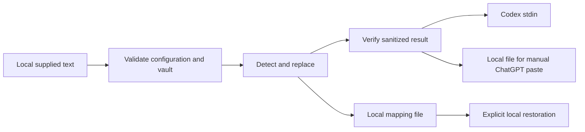

# Hushkey architecture

Status: MVP contract, researched 2026-10-09. Hushkey sanitizes explicitly supplied UTF-8 text locally. Its trusted boundary ends at the sanitized output; it does not promise to mediate every request made by another application.

## Components and ownership

Node 22 ESM TypeScript, with no runtime dependencies. The deterministic core owns detection, non-overlapping replacement, mapping consistency, and explicit restoration. Vault persistence owns local validation and restrictive file permissions. The CLI owns input/configuration parsing and generic errors. Integrations consume sanitized text, never vault serialization. Node's built-in test runner uses synthetic credentials.



## Typed interface contract

The agreed provisional interface is shown below; implementation exports are authoritative if an explicitly coordinated refinement is necessary.

```ts
interface CustomPattern { name: string; pattern: string; flags?: string }
interface ScanOptions { customPatterns?: CustomPattern[] }
interface Finding { kind: string; start: number; end: number }
interface VaultData { version: 1; entries: Record<string, string> }
// entries maps opaque placeholder to original value, exclusively local.
function createVault(): VaultData;
function scan(text: string, options?: ScanOptions): Finding[];
function sanitize(text: string, vault: VaultData, options?: ScanOptions): {
  text: string; findings: Finding[]; replacements: number;
};
function verifySanitized(text: string, vault: VaultData, options?: ScanOptions): void;
function loadVault(path: string): Promise<VaultData>;
function saveVault(path: string, vault: VaultData): Promise<void>;
function restoreToFile(text: string, vault: VaultData, options: {
  authorized: boolean; destination: string; allowedDirectory: string;
}): Promise<void>;
```

Findings expose offsets and rule kinds, never original values. Offsets use JavaScript UTF-16 indices. The same original receives the same placeholder within a persisted vault; distinct values receive distinct placeholders. Placeholders must not expose deterministic secret hashes. Input resembling an existing placeholder must not silently change the meaning of a new mapping. Invalid patterns and zero-length matches must fail with generic errors.

## Operation ordering

1. Read explicit local input and validated configuration. Reject unsupported requested modes.
2. Load and validate the local vault; an absent or corrupt vault blocks protected commands except explicit initialization.
3. Detect supported patterns and known vault values. Resolve overlaps deterministically, preferring an encompassing sensitive span.
4. Replace locally and verify output has no known original value and no detectable remaining findings. Verification failure blocks output and process launch.
5. Persist mappings successfully, then verify the output again against the merged vault before emitting sanitized output or launching Codex. On persistence or verification failure, emit no protected content.
6. Restoration needs explicit authorization and a local destination within an allowed directory. Reject traversal, symlinks, existing outputs, and unsafe destinations; never restore to stdout or a provider.

Mappings are plaintext local sensitive files, protected by mode 0600 and a mode 0700 directory on supported POSIX filesystems. They are not encrypted storage. An exclusive lock blocks contention; append-only merges retain existing mappings and reject conflicts. Atomic replacement and file/directory fsync reduce truncation and durability risks. An abandoned lock requires manual recovery after confirming no active writer. Config and vault errors must not embed input contents or parse excerpts in logs.

## Integration contract

Codex integration is an explicit wrapper around `codex exec -`, passing only verified supplied prompt text to child stdin. The official CLI supports this input mode. It remains possible for Codex to independently load project instructions, configuration, history, files, tool output, MCP data, or images; those paths are outside this wrapper's guarantee. Read-only sandboxing restricts writes, not secret reads. [Official stdin documentation](https://learn.chatgpt.com/docs/non-interactive-mode)

ChatGPT integration is a local companion: write sanitized text locally, then paste only that output. It makes no requests to OpenAI. Original chat messages typed into ChatGPT, file uploads, and tool arguments may reach OpenAI before an app executes. Plugin tools and component-authored messages do not establish a global interception boundary. [Official plugin reference](https://developers.openai.com/plugins/reference)

See [integration research](integration-research.md), [threat model](threat-model.md), and [ADR 001](adr-001.md).
